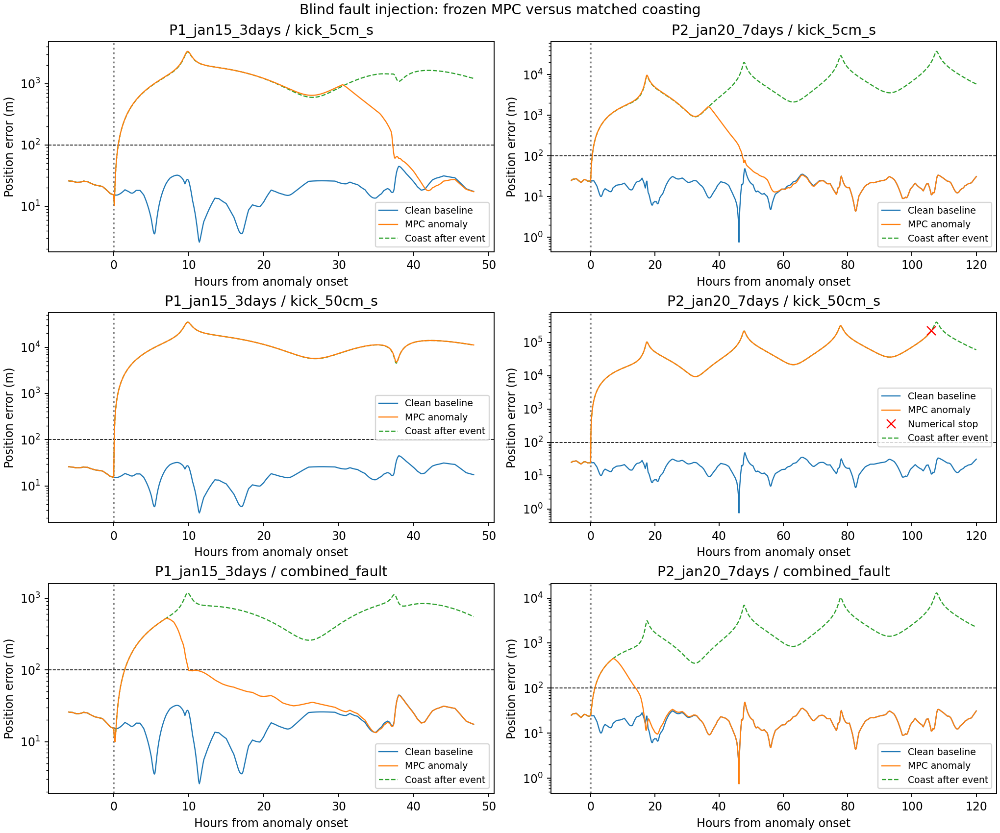
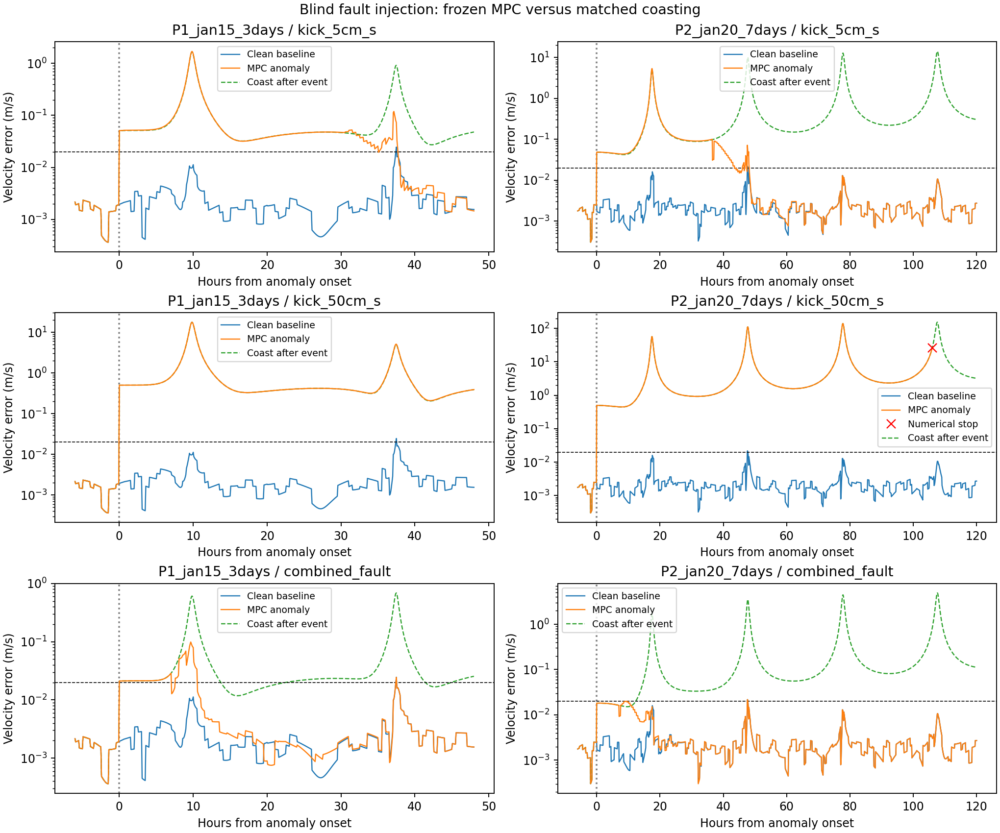

# Blind anomaly injection and automatic recovery

The frozen controller meets the sustained recovery criterion in 14/18 anomaly instances, with 14 also meeting the additional screening conditions. The matched coasting comparisons settle in 0/18 cases. These are finite stress-test outcomes, not estimated probabilities of flight success.

The largest sampled position excursion among recovered/contained floating-point cases is 9723.0 m. Recovery does not mean remaining inside the 100 m corridor throughout the event.

Frozen RoutineMPC/sparse_05 is tested without retuning, manual resets or automatic rearming. Each case starts from one reconstructed ARTEMIS state and follows a reference propagated from that initial state. Later vehicle states, sensor fixes and anomalies are synthetic. Future spacecraft observations are never read. The January geometries were previously used; the fault profiles and noise seeds are new stress evidence, not independent new flight datasets.

Recovery means both position error <=100 m and velocity error <=0.02 m/s for at least six hours continuously through the end, evaluated on five-minute samples. Finite faults are scored after they end; persistent faults require regulation while they remain active. “Contained” means the response never leaves that corridor. “Strict” also requires no clearance/solver/recovery/budget rejection and at least 50 km actual sampled lunar clearance. Temporary stale-navigation inhibition is allowed. No sampled criterion certifies between-sample safety.

The controller receives only its causal navigation estimate, predicted mass and the nominal reference. Impulses modify plant velocity; its first delayed measurement still predates the kick. Sensor bias follows measurement time. Thrust loss changes actual thrust and propellant flow; the filter sees only its issued command history. Fault labels, timings and directions are available to the experiment and scorer only.

The generic vehicle starts at 500 kg with 0.2 N thrust and 220 s specific impulse. Faults start 24 h into the three-day P1 run and 48 h into the seven-day P2 run. Existing random force bias, 30 m / 0.002 m/s noisy fixes, 60 s delivery delay and finite-burn errors remain. The amplitudes below are declared engineering stress cases, not estimates of flight fault probabilities.

| Anomaly | Injected change |
|---|---|
| kick_5mm_s / kick_5cm_s / kick_50cm_s | Instantaneous plant-only velocity jump of 0.005 / 0.05 / 0.5 m/s in a seeded inertial direction |
| acceleration_pulse | Unknown 2e-6 m/s² inertial acceleration for 6 h |
| persistent_force_error | Unknown 3e-7 m/s² inertial acceleration through the end |
| half_thrust_24h | Actual thrust and propellant flow reduced to 50% for 24 h; command model unchanged |
| navigation_bias_6h | Sensor bias of 150 m position and 0.006 m/s velocity for 6 h |
| combined_fault | 0.02 m/s kick, 6 h navigation outage, 75% actual thrust/flow for 12 h |
| permanent_thrust_failure | Zero actual thrust and propellant flow from onset onward |

Scored 58 cases: 56 completed their full duration and 2 stopped on numerical exceptions. Propagated 288.875 of 290 requested simulated days. The matrix has two geometries, nine anomalies each, four clean arithmetic baselines, eighteen matched no-correction comparisons and both floating-point/32-bit MPC. No-correction comparisons share the entire controlled pre-event trajectory and then coast.

Floating-point outcomes across eighteen anomaly instances: {'contained': 1, 'recovered': 13, 'not_recovered': 4}; strict successes 14/18. Coast comparisons that settle: 0/18.

## P1_jan15_3days

| Anomaly | Response | Strict | Settling from onset (h) | Peak error (m) | Last error (m) | Extra issued Δv (m/s) | Coast at same epoch (m) |
|---|---|---|---:|---:|---:|---:|---:|
| acceleration_pulse | recovered | True | 37.67 | 1452.53 | 17.50 | +0.37727 | 2045.61 |
| combined_fault | recovered | True | 37.58 | 525.51 | 17.50 | +0.41255 | 553.53 |
| half_thrust_24h | recovered | True | 37.58 | 44.85 | 17.43 | -0.00513 | 140.35 |
| kick_50cm_s | not_recovered | False | — | 34889.12 | 11205.14 | -0.15440 | 11174.50 |
| kick_5cm_s | recovered | True | 37.75 | 3348.98 | 17.27 | +0.30688 | 1212.26 |
| kick_5mm_s | recovered | True | 37.58 | 44.60 | 17.45 | +0.00457 | 233.94 |
| navigation_bias_6h | recovered | True | 37.58 | 427.01 | 16.90 | -0.01893 | 140.35 |
| permanent_thrust_failure | not_recovered | False | — | 956.29 | 140.35 | +0.07601 | 140.35 |
| persistent_force_error | recovered | True | 37.58 | 46.84 | 11.99 | +0.02039 | 779.26 |

## P2_jan20_7days

| Anomaly | Response | Strict | Settling from onset (h) | Peak error (m) | Last error (m) | Extra issued Δv (m/s) | Coast at same epoch (m) |
|---|---|---|---:|---:|---:|---:|---:|
| acceleration_pulse | recovered | True | 47.83 | 90.59 | 31.14 | +0.06603 | 4258.32 |
| combined_fault | recovered | True | 47.83 | 455.15 | 31.13 | +0.04368 | 2282.21 |
| half_thrust_24h | recovered | True | 47.83 | 48.85 | 31.13 | +0.06508 | 230.25 |
| kick_50cm_s | numerical failure | False | — | 318845.73 | 222852.00 | -0.33724 | 222388.69 |
| kick_5cm_s | recovered | True | 48.17 | 9722.98 | 31.14 | +0.33599 | 5911.43 |
| kick_5mm_s | recovered | True | 47.83 | 48.70 | 31.14 | +0.00516 | 490.53 |
| navigation_bias_6h | recovered | True | 47.83 | 379.76 | 31.14 | +0.30885 | 230.25 |
| permanent_thrust_failure | not_recovered | False | — | 3346.20 | 230.25 | +0.14854 | 230.25 |
| persistent_force_error | contained | True | 0.00 | 45.13 | 39.41 | +0.04344 | 1543.41 |

## Numerical exceptions

These cases terminate at the recorded failure time. Their last error and RMS cover only the available partial history, not the full requested duration. Status 512 is a terminal annotation from the experiment; it is not an onboard recovery mode. No state reset or further trajectory propagation follows the failed numerical check.

| Geometry | Anomaly | Arithmetic | Control | Stop (h) | Error |
|---|---|---|---|---:|---|
| P2_jan20_7days | kick_50cm_s | 32 | routine_mpc | 155.00 | Negative variance |
| P2_jan20_7days | kick_50cm_s | float64 | routine_mpc | 154.00 | Negative variance |

Extra issued delta-v is relative to the same geometry/noise clean baseline. A negative value can mean inhibited control or early termination, not improved fuel efficiency. Actual delivered delta-v, propellant, rejection counts and recovery latch times are retained in JSON. All cases, including failures and permanent actuator loss, are included.

32/24 arithmetic agrees on response classification in 18/18 anomaly instances. The hardware controller and fault recovery have not been synthesized or flight-qualified.

Validation: 370 tests, 69 frozen numerical source files, 9 hashed physical inputs, full case matrix, exact pre-event pairing, recomputed recovery metrics and correction budgets, and packaged-module hashes. Failed runs retain their actual stopping times; no continuation of an invalid navigation state is credited as recovery.

The same nominal force model underlies reference, estimator and plant; plant-only faults add model mismatch. This is a controlled causal simulation experiment, not proof against arbitrary faults or validation of direct shape-sphere dynamics.

Settling time is conservative: it begins after the last corridor excursion and includes background tracking excursions also present in the clean baseline. It is not an isolated fault-detection latency. The position-only plot cannot establish the velocity criterion; both histories are supplied.

An earlier batch attempt was stopped because NumPy burn-count integers could not be serialized to JSON. The repaired harness converts those counts to builtin integers and reports errors immediately. The fault protocol and all 68 prior numerical source files remained unchanged; timing diagnostics and abandoned work are excluded from the 58 scored runs. Receipt: `harness-repair.json` in the campaign directory.

The initial batch saved 37 cases before a navigation covariance exception stopped it. A separate continuation retained those exact records and ran only the unfinished cases, capturing exceptions with their partial histories. Both phases use identical frozen numerical sources, physical inputs and fault protocol; no successful case was replaced.





## Reproduction

```sh
PYTHONPATH=. OPENBLAS_NUM_THREADS=1 OMP_NUM_THREADS=1 \
python scripts/artemis_anomaly_campaign.py --output /path/to/new-campaign \
  --data /path/to/ARTEMIS-SPKs --kernels /path/to/planetary-kernels \
  --physics /path/to/lunar-inputs --native /path/to/liblunar.so --workers 4
# If a numerical exception stops the batch, retain its results and continue:
PYTHONPATH=. OPENBLAS_NUM_THREADS=1 OMP_NUM_THREADS=1 \
python scripts/artemis_anomaly_continuation.py --output /path/to/new-campaign \
  --data /path/to/ARTEMIS-SPKs --kernels /path/to/planetary-kernels \
  --physics /path/to/lunar-inputs --native /path/to/liblunar.so --workers 8
PYTEST_DISABLE_PLUGIN_AUTOLOAD=1 python -m pytest -q > /path/to/new-campaign/pytest.log
python -m pip wheel . --no-deps --no-build-isolation -w /path/to/new-campaign/wheels
PYTHONPATH=. python scripts/report_artemis_anomalies.py /path/to/new-campaign
```
