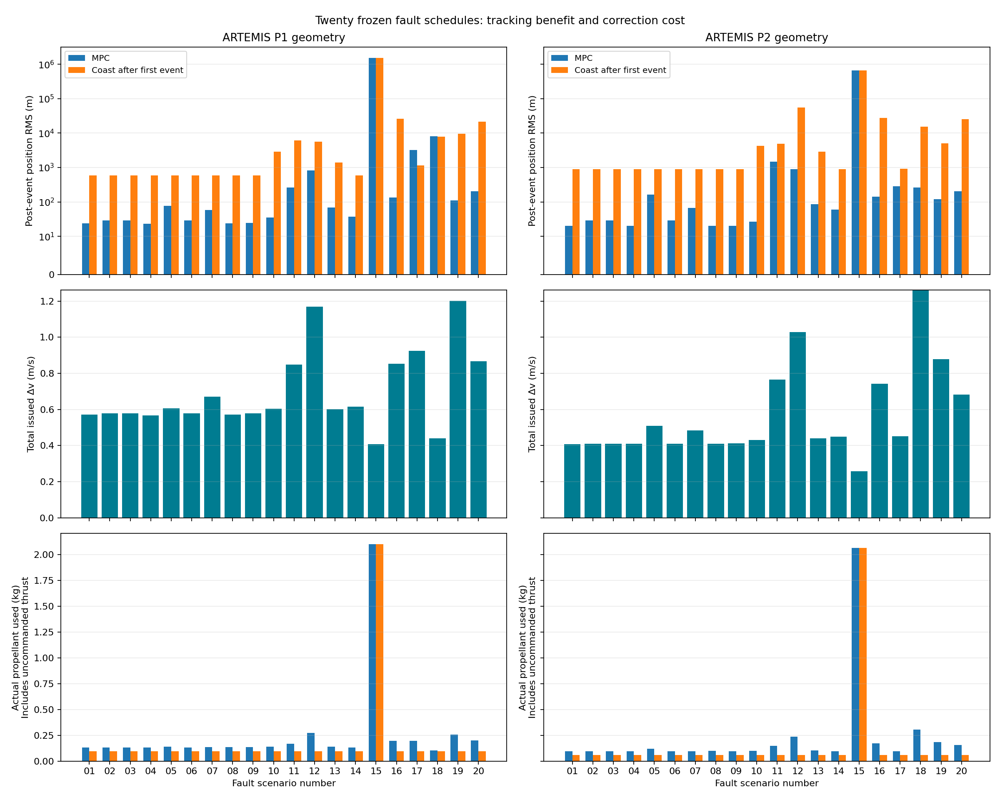

# Concurrent and consecutive fault campaign

Twenty new synthetic fault schedules: 10 individual faults, 5 simultaneous combinations, 5 ordered sequences. Two reconstructed ARTEMIS initial geometries, three days each, new noise seeds 14001/14002, float64 and 32/24 MPC, matched coasting comparisons and clean controls. Subsequent spacecraft motion and fixes are simulated; this is not a replay of observed spacecraft fault responses.

Declared 124 cases; 124 completed; 0 exceptions; 0 modeled collisions. 411 tests passed.

## Handling policy

The current tested policy quarantines malformed/replayed/future sensor packets, retains the last valid square-root estimate, requires sustained evidence for provisional or post-outage reacquisition, inhibits routine thrust while navigation is untrusted, and retains the existing error envelope, clearance screen and daily issued-Δv limit. It does not automatically rearm the recovery latch. Numerical filter failures are surfaced separately from malformed inputs. Runtime telemetry write failures are contained so guidance can continue.

A persistent local event journal queues status changes, reacquisitions and issued commands. A simulated receiver deduplicates and acknowledges events when the link returns. Ground-link outage does not remove onboard navigation fixes. No external notifications are sent. This is not a real radio, ground-command or flight-storage implementation.

For this architecture, the supported next design is layered fault detection/isolation/recovery, with an independent protective response, resource-aware recovery planning and ground review/intervention. NASA’s [fault-detection guidance](https://swehb.nasa.gov/spaces/SWEHBVD/pages/102695798/9.07%2BFault%2BDetection%2Band%2BResponse) emphasizes autonomous protection that preserves resources and commandability, with timely autonomous action for critical activities. These tests do not select a globally optimal controller or validate a safe emergency maneuver planner.

## Results by category (float MPC only)

| Category | Instances | Navigation restored | Nominal trajectory restored | Observed safety checks passed |
|---|---:|---:|---:|---:|
| single | 20 | 20 | 20 | 20 |
| concurrent | 10 | 10 | 8 | 10 |
| consecutive | 10 | 9 | 8 | 10 |

Navigation restoration requires trusted position error ≤200 m and velocity error ≤0.02 m/s for the final 6 h after the schedule ends. Trajectory restoration uses ≤100 m and ≤0.02 m/s over that interval. Observed safety means full completion, no modeled collision, recorded lunar clearance ≥50 km and remaining propellant ≥0.5 kg. It does not establish future survivability, power/thermal/attitude safety or mission success.

Matched coasting restores the nominal corridor in 0/40 cases and passes the observed safety checks in 40/40. Counts describe these deliberately chosen scenarios, not flight reliability probabilities.

MPC lowers post-event position RMS in 36/40 matched comparisons, raises it in 3, and has a median reduction of 96.0%. The comparison is against stopping commanded corrections at the first event; it does not establish fuel superiority over another capable controller. Actual propellant, including uncommanded thrust, is recorded separately from issued Δv in the JSON results.

## All twenty schedules

| Scenario | Description | P1 navigation / tracking | P2 navigation / tracking | MPC Δv P1 / P2 (m/s) |
|---|---|---|---|---:|
| 01_ground_blackout | 48h ground-link loss with onboard fixes retained | yes / yes | yes / yes | 0.572 / 0.407 |
| 02_future_sensor_clock | Fix timestamps120s ahead for6h | yes / yes | yes / yes | 0.578 / 0.409 |
| 03_replayed_navigation | Replay the last delivered packet for6h | yes / yes | yes / yes | 0.578 / 0.409 |
| 04_nonfinite_fix | One delivered fix contains a NaN velocity | yes / yes | yes / yes | 0.568 / 0.410 |
| 05_unreported_noise | Fivefold sensor noise for12h; reported covariance unchanged | yes / yes | yes / yes | 0.608 / 0.509 |
| 06_position_bias | 1km position-only sensor bias for6h | yes / yes | yes / yes | 0.578 / 0.409 |
| 07_temporary_thrust_loss | Zero delivered commanded thrust and flow for12h | yes / yes | yes / yes | 0.671 / 0.485 |
| 08_thrust_overdelivery | 150% delivered thrust and flow for12h | yes / yes | yes / yes | 0.571 / 0.410 |
| 09_pointing_error | 60degree command-direction rotation for12h | yes / yes | yes / yes | 0.579 / 0.412 |
| 10_ramping_force | Unknown acceleration ramps0 to2e-6m/s² over12h | yes / yes | yes / yes | 0.605 / 0.430 |
| 11_kick_and_weak_thrust | 0.1m/s kick plus50% thrust for12h | yes / yes | yes / yes | 0.849 / 0.765 |
| 12_kick_and_sensor_loss | 0.2m/s kick plus3h navigation outage | yes / yes | yes / yes | 1.170 / 1.029 |
| 13_force_and_sensor_bias | 12h force error plus6h biased position/velocity | yes / yes | yes / yes | 0.602 / 0.441 |
| 14_pointing_weak_thrust_noise | Mispointing,70% thrust loss and unreported noise | yes / yes | yes / yes | 0.615 / 0.449 |
| 15_stuck_thrust_blackout | Uncommanded0.2N thrust6h plus3h sensor and48h ground outages | yes / no | yes / no | 0.409 / 0.257 |
| 16_three_velocity_steps | Independent0.03/0.05/0.08m/s kicks12h apart | yes / yes | yes / yes | 0.853 / 0.744 |
| 17_force_bias_then_actuator | Force pulse, sensor bias, then12h thrust loss | yes / no | yes / yes | 0.925 / 0.451 |
| 18_bad_sensor_return_then_kick | 6h outage,6h noisy return, then0.2m/s kick | no / no | yes / yes | 0.440 / 1.312 |
| 19_thrust_kick_clock | Thrust loss, subsequent kick, then malformed sensor clock | yes / yes | yes / yes | 1.201 / 0.879 |
| 20_cascading_failures | Kick, outage, force pulse, weak thrust, final bad packet during recovery | yes / yes | yes / yes | 0.866 / 0.682 |

## Unrecovered cases

| Geometry / scenario | Final navigation error (m) | Final trajectory error (km) | Post-event RMS MPC / coast (km) |
|---|---:|---:|---:|
| P1_compound / 15_stuck_thrust_blackout | 18.7 | 819.360 | 1553.670 / 1553.670 |
| P1_compound / 17_force_bias_then_actuator | 19.0 | 1.662 | 3.261 / 1.162 |
| P1_compound / 18_bad_sensor_return_then_kick | 3755.8 | 4.235 | 8.191 / 7.949 |
| P2_compound / 15_stuck_thrust_blackout | 18.2 | 316.329 | 669.926 / 669.733 |

All campaign journals: 9663 events, 9663 delivered to the simulated receiver, 0 pending and 0 dropped at run end. Maximum backlog 66 events; longest delivery delay 48.0 h. Separate tests exercise restart, a lost acknowledgment, corruption, capacity overflow and storage failure.

The stuck-thrust schedule ends by construction after six hours; the controller has no independent valve-shutoff mechanism. Its small issued-Δv total must not be mistaken for small fuel use: uncommanded propulsion drives actual consumption to about 2.1 kg. Both geometries regain navigation but exceed the routine tracking envelope. P1 schedule 17 also latches recovery-required status; P1 schedule 18 remains navigation-untrusted after noisy measurements and a later kick. The [failure-handling design note](compound-fault-handling.md) explains the resulting implementation priorities.

## Verification and limitations

Verified 78 source/test/runner hashes, 9 physical inputs, the built wheel, 17572 nonnegative innovation statistics, 1395 zero-thrust checks while navigation is untrusted, 5828 exact causal-prefix comparisons and all saved telemetry journals. Uncommanded propulsion is integrated with both its force and mass flow; overlapping jets combine vector forces and summed flows at exact burn boundaries.

42 complete arithmetic pairs; all tracking/navigation classifications and burn counts match: True. Only the QP executes in integer host emulation; navigation, physics and supervision remain float64. No FPGA synthesis or execution-time/power guarantee.

The earlier navigation campaign exposed empirical covariance undercoverage; positive covariance does not certify a safety margin. Coherent bad sensor data can still mimic real motion. The routine envelope/recovery latch conserves authority but provides no validated survival trajectory. Three-day runs, synthetic direct-state fixes, fixed thrust-direction error and abstract force disturbances leave substantial flight validation work.

