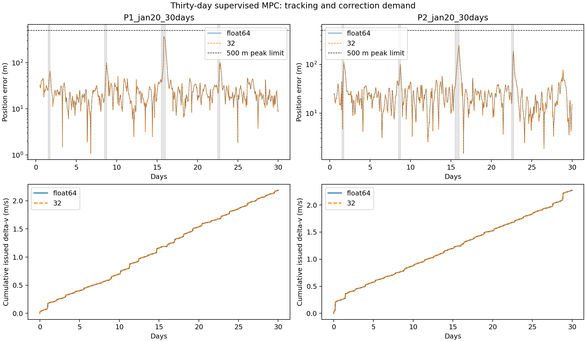

# MPC hardening and extended mission results

The first revision hardened solver/navigation interfaces and compared four outage policies. It retained the original sparse MPC. Seven-day fresh tests then exposed runaway routine correction demand and numerical range failures. The second revision adds an explicit tracking-error envelope and rolling issued-delta-v budget. The failing evidence remains included.

The second revision replays a benign and a failed case, then uses new January 20 initial geometries and seeds for two 30-day missions, each in float64 and 32/24 integer arithmetic. Limits were frozen before these endurance runs. Replays are diagnostics, not fresh evidence. The earlier proposed endurance phase was replaced by this supervised revision after the fresh failure.

All spacecraft motion and sensor fixes after the single reconstructed ARTEMIS initial state are synthetic. The initial orbit product may itself incorporate later historical tracking. Later planetary ephemerides supply forces; later spacecraft states never enter guidance.

## Development alternatives

| Profile | Worst RMS (m) | Worst peak (m) | Mean delta-v (m/s) | Mean burns | Failed cases |
|---|---:|---:|---:|---:|---:|
| legacy | 68.361 | 221.260 | 0.35599 | 87.00 | 0/4 |
| decay_only | 145.172 | 514.208 | 0.35501 | 77.00 | 2/4 |
| guarded | 70.582 | 311.671 | 0.36794 | 97.00 | 0/4 |
| decay_guarded | 100.041 | 435.021 | 0.34570 | 80.50 | 1/4 |

## earlier/fresh

| Case | Arithmetic | Days | Steady RMS (m) | Steady peak (m) | Delta-v (m/s) | Burns | Recovery-required updates | Solver/screen faults |
|---|---|---:|---:|---:|---:|---:|---:|---:|
| P1_jan15_9201 | float64 | 3 | 39.667 | 145.496 | 0.46293 | 87 | 0 | 0 |
| P1_jan15_9201 | 32 | 3 | 39.667 | 145.495 | 0.46292 | 87 | 0 | 0 |
| P1_jan15_9202 | float64 | 3 | 24.659 | 43.669 | 0.38329 | 89 | 0 | 0 |
| P1_jan15_9202 | 32 | 3 | 24.659 | 43.668 | 0.38329 | 89 | 0 | 0 |
| P2_jan15_9201 | float64 | 3 | 39.477 | 114.338 | 0.37455 | 92 | 0 | 0 |
| P2_jan15_9201 | 32 | 3 | 39.477 | 114.337 | 0.37455 | 92 | 0 | 0 |
| P2_jan15_9202 | float64 | 3 | 64.713 | 238.413 | 0.36195 | 93 | 0 | 0 |
| P2_jan15_9202 | 32 | 3 | 64.713 | 238.413 | 0.36195 | 93 | 0 | 0 |
| P1_jan18_9201 | float64 | 7 | 76.917 | 303.627 | 0.84170 | 198 | 0 | 1 |
| P1_jan18_9201 | 32 | 7 | 76.917 | 303.625 | 0.84167 | 198 | 0 | 1 |
| P1_jan18_9202 | float64 | 7 | 463647.461 | 2467748.428 | 26.66267 | 243 | 0 | 1 |
| P1_jan18_9202 | 32 | 7 | 389939.270 | 1983442.004 | 22.01958 | 212 | 0 | 32 |
| P2_jan18_9201 | float64 | 7 | 42.808 | 147.460 | 0.44547 | 190 | 0 | 0 |
| P2_jan18_9201 | 32 | 7 | 42.808 | 147.459 | 0.44547 | 190 | 0 | 0 |
| P2_jan18_9202 | float64 | 7 | 52.511 | 195.224 | 0.43725 | 192 | 0 | 0 |
| P2_jan18_9202 | 32 | 7 | 52.511 | 195.226 | 0.43724 | 192 | 0 | 0 |

## supervised/regression

| Case | Arithmetic | Days | Steady RMS (m) | Steady peak (m) | Delta-v (m/s) | Burns | Recovery-required updates | Solver/screen faults |
|---|---|---:|---:|---:|---:|---:|---:|---:|
| P1_jan15_regression | float64 | 3 | 39.667 | 145.496 | 0.46293 | 87 | 0 | 0 |
| P1_jan15_regression | 32 | 3 | 39.667 | 145.495 | 0.46292 | 87 | 0 | 0 |
| P1_jan18_failure_replay | float64 | 7 | 102054.220 | 513398.612 | 0.21534 | 53 | 213 | 1 |
| P1_jan18_failure_replay | 32 | 7 | 102053.726 | 513396.186 | 0.21536 | 53 | 213 | 1 |

## supervised/endurance

| Case | Arithmetic | Days | Steady RMS (m) | Steady peak (m) | Delta-v (m/s) | Burns | Recovery-required updates | Solver/screen faults |
|---|---|---:|---:|---:|---:|---:|---:|---:|
| P1_jan20_30days | float64 | 30 | 42.416 | 369.293 | 2.18633 | 866 | 0 | 2 |
| P1_jan20_30days | 32 | 30 | 42.416 | 369.292 | 2.18642 | 866 | 0 | 2 |
| P2_jan20_30days | float64 | 30 | 36.167 | 247.696 | 2.26994 | 905 | 0 | 0 |
| P2_jan20_30days | 32 | 30 | 36.167 | 247.695 | 2.26996 | 905 | 0 | 0 |

Steady metrics use five-minute samples after the first 12 hours. Full-arc errors are retained in JSON. Delta-v and burns cover the complete simulation. Tracking limits are 100 m steady RMS / 500 m sampled peak; tighter targets are 50 m / 300 m. Completion does not mean the mission remained within those limits.

The failed seven-day P1 reference has a sampled minimum lunar clearance of 37.8 km, below the controller's 50 km first-burn clearance floor. The replay first rejects a burn at day 1.8333. Returning navigation fixes are repeatedly rejected before the estimated tracking error triggers the recovery latch at day 2.5625. These observations identify reference-feasibility and navigation-reacquisition limitations; they do not isolate a single causal explanation for the failure. Routine inhibition reduces expenditure but does not constitute fuel-efficient mission completion.

The new 30-day runs both meet the 100 m RMS / 500 m peak tracking limits in both arithmetic formats. P2 also meets the tighter 50 m / 300 m limits without a screen or numerical rejection. P1 does not pass the no-rejection gate: its nominal reference reaches 45.9 km lunar clearance and it rejects first burns on days 26.125 and 27.25. Neither run enters recovery-required or budget-wait mode. Successful tracking of an inadmissible reference is not mission feasibility.

Status 32 is a first-burn clearance rejection, not a floating-point arithmetic failure. Status 64 means the estimated state left the routine local-control envelope and the controller latched a recovery-required state. Status 128 waits for rolling issued-delta-v headroom. Zero output is not a certified safe trajectory or an emergency maneuver. The operator or a separately validated recovery planner must provide a viable plan before explicit rearming.

Verification: 44 runs / 280 simulated days, 366 tests, 1,200 native sanitizer fault/range cases, current source and frozen-snapshot hashes, complete case matrices and recomputed metrics. The integer QP core is host-tested; no FPGA synthesis, RTL timing or power measurements were performed.

