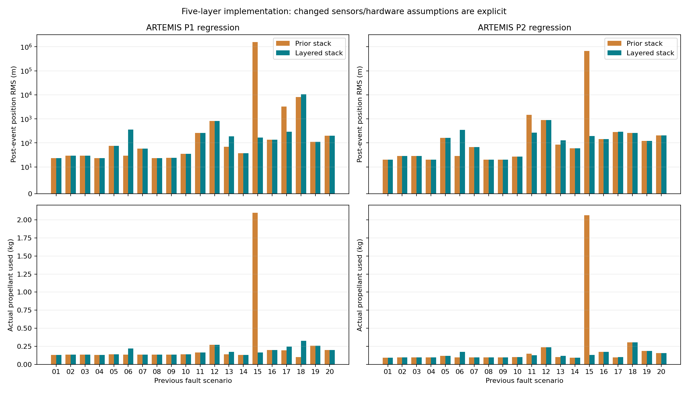

# Layered autonomy results

The five implementation layers are described in [the design and interface note](layered-autonomy.md). This is a frozen host simulation with real reconstructed ARTEMIS initial states and synthetic subsequent trajectories, navigation fixes, thrust/flow telemetry and ground messages. The added independent sensors, shutoff and backup bank are hardware assumptions, not benefits of a coordinate transformation.

118/118 runs completed over 354 simulated days; 0 exceptions and 0 modeled collisions. 433 tests passed. The prior 124-run campaign remains archived.

| Split (float layered stack) | Cases | Navigation restored | Nominal trajectory restored |
|---|---:|---:|---:|
| Previous scenarios | 40 | 40 | 39 |
| Fresh schedules/seeds | 12 | 12 | 5 |

Navigation restoration requires trusted error ≤200 m and ≤0.02 m/s; trajectory restoration requires ≤100 m and ≤0.02 m/s, sustained through the final six hours after the schedule ends. Counts are outcomes of selected scenarios, not reliability probabilities. No collision alone does not establish a survival advantage.

Across the 40 regression comparisons, post-event RMS improves in 4 and worsens in 6 (using a 1 mm reporting tolerance). Restoration counts do not conceal these error tradeoffs.

## Previous missed cases

| Geometry / case | Old → new final navigation error (m) | Old → new final path error (km) | Old → new propellant (kg) |
|---|---:|---:|---:|
| P1_compound / 15_stuck_thrust_blackout | 18.7 → 19.3 | 819.360 → 0.023 | 2.097 → 0.163 |
| P1_compound / 17_force_bias_then_actuator | 19.0 → 19.2 | 1.662 → 0.025 | 0.196 → 0.245 |
| P1_compound / 18_bad_sensor_return_then_kick | 3755.8 → 19.0 | 4.235 → 6.200 | 0.102 → 0.324 |
| P2_compound / 15_stuck_thrust_blackout | 18.2 → 18.2 | 316.329 → 0.021 | 2.062 → 0.132 |

## Fresh cases

| Geometry / schedule | Navigation / tracking restored | Final path error (km) | Propellant (kg) |
|---|---|---:|---:|
| P1_fresh / 21_noisy_outage_then_kick | True / True | 0.036 | 0.301 |
| P1_fresh / 22_second_kick_in_blackout | True / True | 0.041 | 0.393 |
| P1_fresh / 23_long_stuck_thruster | True / True | 0.036 | 0.184 |
| P1_fresh / 24_failed_isolation | True / False | 265.704 | 2.053 |
| P1_fresh / 25_ground_authority | True / False | 18.214 | 0.029 |
| P1_fresh / 26_beyond_routine_envelope | True / False | 67.696 | 0.056 |
| P2_fresh / 21_noisy_outage_then_kick | True / True | 0.024 | 0.448 |
| P2_fresh / 22_second_kick_in_blackout | True / False | 17.684 | 0.326 |
| P2_fresh / 23_long_stuck_thruster | True / True | 0.021 | 0.209 |
| P2_fresh / 24_failed_isolation | True / False | 105.514 | 2.091 |
| P2_fresh / 25_ground_authority | True / False | 6.070 | 0.083 |
| P2_fresh / 26_beyond_routine_envelope | True / False | 13.713 | 0.093 |

## Failure diagnoses and conditional advantages

The persistent-rejection repair removes the earlier navigation lockout, but it also promotes a coherent biased sensor track. In the 1 km position-bias cases, guidance accepts the estimate at hour 18 and commands a correction while its actual navigation error is 990 m (P1) or 1,015 m (P2); the reported position 3σ bound is only about 44.6 m. Post-event RMS rises from 29.3 to 362.3 m on P1 and from 28.7 to 345.9 m on P2. The final six-hour recovery count does not imply accurate navigation throughout the run. Independent navigation evidence or a separately validated limited-authority reacquisition mode is still needed before promoting such a track to full tracking authority.

In the P1 outage/noisy-return/later-kick case, final navigation error improves from 3,756 m to 19 m, while final path error worsens from 4.235 to 6.200 km and actual fuel rises from 0.102 to 0.324 kg. The supervisor reaches its shared budget and then uses screened coasting outside routine authority. This repairs estimation lockout without demonstrating mission return.

With working independent shutoff, all four stuck-thrust geometry/schedule combinations request isolation 120 s after onset and enable the backup after another 120 s of closed/quiet confirmation. The new twelve-hour stuck-thrust schedule recovers the trajectory in both geometries, using 0.184/0.209 kg versus 3.057/3.094 kg in the matched legacy runs. When isolation is unavailable, the request does not stop thrust or enable backup; final path errors remain 265.704/105.514 km, identical to the matched legacy runs. Physical isolation is therefore a load-bearing hardware dependency.

The ground command sequence accepts the authorized hold, rejects the bad signature and replay, rejects the blackout-delayed expired resume, and accepts a fresh resume at hour 61. Permission is restored without bypassing local gates. Neither geometry returns to the nominal path in the remaining 11 hours (18.214/6.070 km final error). The P2 repeated-kick case and both 0.65 m/s kick cases also retain navigation but fail mission return. A six-hour feasible coast does not establish a return corridor or months of survival.

These comparisons identify benefits of the combined new stack under additional sensing/actuation assumptions; they do not isolate every software layer causally or demonstrate a shape-sphere advantage. An independently reachable recovery reference, an explicit terminal return constraint and an actuator/attitude-coupled contingency optimizer are candidate next changes, to be tested with new schedules rather than tuned to these final holdouts.

## Verification and limits

Verified 146 source/test/bridge hashes and 9 input files; 3840 pre-event comparisons, 4 ground-only independence checks, 1111 untrusted-navigation and 476 isolation inhibits. Maximum rolling issued Δv: 0.999641 m/s against the 1 m/s limit.

All 54 arithmetic pairs match tracking/navigation outcomes and burn counts: True. Maximum RMS difference 1.9975 m; maximum issued-Δv difference 8.04309e-05 m/s. Only the QP is integer host emulation; there is no synthesized FPGA timing or power result.

Outbox events 11970; acknowledged 11970; pending 0; dropped 0. The ground receiver is local and simulated. The command test rejects bad signatures, repeated sequences and expired blackout-delayed messages.

The initial development planner minimized reference error plus a burn penalty and spent excessive protective effort on the P1 lockout case. Its eight development results are retained. Before the final holdouts, the policy was changed to prefer a feasible screened coast and require renewed in-corridor trust before returning to routine tracking. The frozen final policy is not retuned after these outcomes.

The campaign executes 1046 protective planning decisions, including 0 screened-burn choices. The separate synthetic impact unit test exercises an active avoidance burn. Host computation time does not advance physical simulation time; scheduling isolation, watchdog behavior and execution deadlines require hardware integration.

Thrust isolation is conditional on independent hardware and sensor availability. The failed-isolation cases retain continuing physical thrust and inhibit backup use. The protective ensemble is a finite diagnostic screen, not a certified uncertainty tube; covariance calibration, attitude coupling, power/thermal dynamics, physical sensor observability and flight storage remain open. The campaign does not yet integrate the separate RCS/attitude allocation module.

