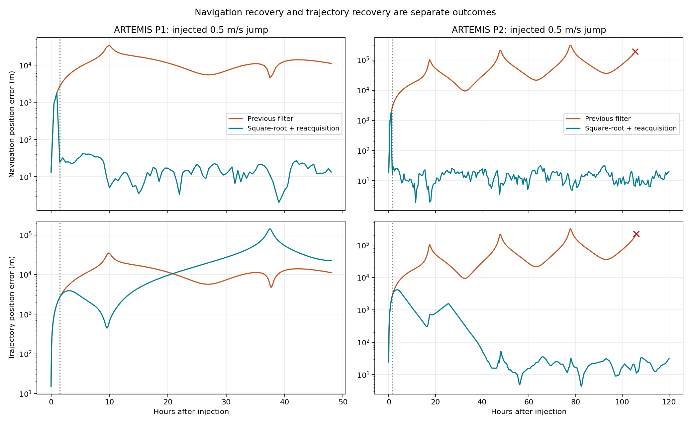
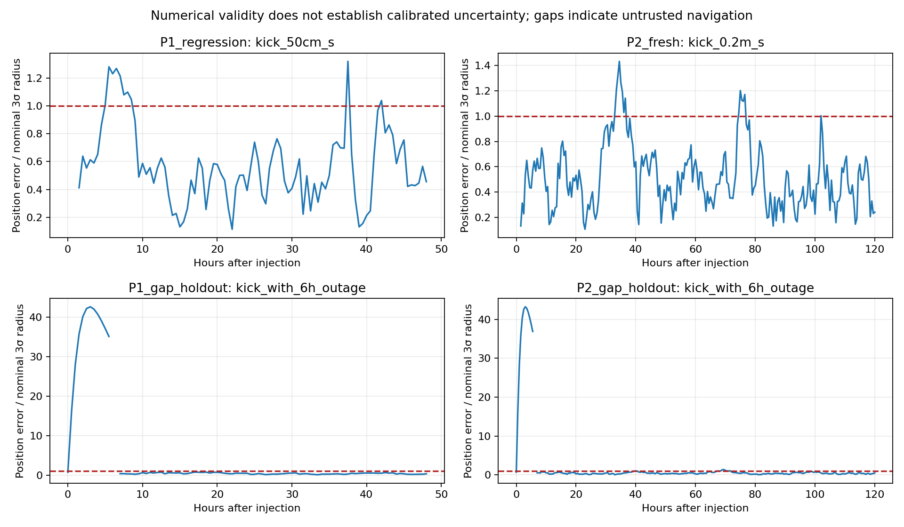

# Navigation recovery and covariance repair

The campaign freezes the implementation and 61 scenarios/arithmetic combinations before execution. Each trajectory starts from one reconstructed ARTEMIS state; subsequent spacecraft dynamics and sensor fixes are simulated.

V3 retains V2’s original regression/fresh split names for provenance; those cases are now reused development cases. Only the additional gap_holdout cases use new noise/direction seeds unseen before the cold-reacquisition repair. Their initial geometries are reused eligible references. V2 evidence and its 100.5-hour outage-recovery miss are retained separately.

Completed 47/61 declared cases. Reference preflight rejections: 14; numerical terminations: 0.

The user’s objective is ground-supervised autonomy: ground may authorize the mission to run autonomously and observe; the spacecraft should react to anomalies, adjust within authority, and report to ground for review/intervention. It must also preserve survival during extended loss of ground contact. Navigation restoration, observed clearance/resource preservation and return to the original trajectory are separate criteria. Synthetic navigation fixes are assumed available without ground except in declared sensor outages. This is a short-duration simulated navigation/control test, not a demonstrated onboard sensor system or long-blackout survival guarantee.

The tested measurement cadence is 30 minutes. Three-fix confirmation normally takes 90 minutes after injection; this does not validate a fast emergency protection loop. The current bounded in-memory navigation log is not a persistent ground notification/acknowledgment system.

Across executed cases: 47 completed without a modeled collision; minimum recorded lunar clearance 257.073 km; maximum propellant use 0.4297 kg from an initial 20 kg propellant load. Power, thermal, attitude, communications reacquisition and future safe-return feasibility are not scored.

## Reproduced covariance failure

The archived P2 replay produces NIS -503.186075, despite NIS being nonnegative by definition. Prior position variance reaches 6.88105e+19 m²; the innovation covariance condition number is 2.39212e+24. Five of six measurement variances round away when added to the prior. The negative NIS passes the old upper-bound gate; the subsequent Joseph update produces a negative velocity variance. No invalid process-noise matrix was detected.

The repair stores covariance factors, propagates them with QR, and conditions a joint state/measurement factor. NIS is a squared norm after triangular whitening. The live factor is never reconstructed from a rounded full covariance. All updates validate before committing state, factors, clocks or counters. This follows standard square-root filtering principles; see [JPL’s square-root derivation](https://ipnpr.jpl.nasa.gov/progress_report/42-233/42-233A-orig.pdf).

## Reacquisition and its limits

A significant rejected velocity discrepancy seeds one separate provisional track. At least three distinct fixes over an hour must fit its propagated motion, including known finite burns, and pass uncertainty limits. The provisional track replaces the prior only after confirmation; correlated estimates are not fused as independent. MPC is inhibited while navigation is suspect. Existing 5 km / 0.5 m/s authority limits and 1 m/s daily issued budget remain.

A separate cold-reacquisition path starts after a real gap of more than three hours in received fixes. It does not require agreement with the stale prior, but still requires three dynamically consistent fixes. Repeated rejected fixes cannot themselves activate this path. Its event reason is observation_gap, not proof of an impulse.

A dynamically coherent sensor fault is observationally indistinguishable from a real jump in this single direct-state stream. Passing these tests establishes conditional consistency, not authenticated physical origin. Independent sensors, realistic tracking observables and covariance calibration remain necessary.

## Float results

| Geometry / split | Fault | Navigation recoveries | First confirmation after onset (h) | Final navigation error (m) | Trajectory response | Final trajectory error (m) | Issued Δv (m/s) | Min lunar clearance (km) |
|---|---|---:|---:|---:|---|---:|---:|---:|
| P1_fresh / maneuver_aware | kick_0.2m_s | 0 | — | — | not_run | — | — | — |
| P1_fresh / maneuver_aware | kick_0.75m_s | 0 | — | — | not_run | — | — | — |
| P1_fresh / maneuver_aware | kick_1.25m_s | 0 | — | — | not_run | — | — | — |
| P1_fresh / maneuver_aware | kick_with_outage | 0 | — | — | not_run | — | — | — |
| P1_fresh / maneuver_aware | none | 0 | — | — | not_run | — | — | — |
| P1_fresh / maneuver_aware | position_velocity_bias_6h | 0 | — | — | not_run | — | — | — |
| P1_fresh / maneuver_aware | velocity_bias_6h | 0 | — | — | not_run | — | — | — |
| P1_gap_holdout / maneuver_aware | bad_velocity_after_outage | 0 | — | 10.370 | recovered | 11.191 | 0.701 | 262.996 |
| P1_gap_holdout / maneuver_aware | kick_with_6h_outage | 1 | 7.000 | 10.437 | not_recovered | 26597.410 | 0.409 | 257.174 |
| P1_gap_holdout / maneuver_aware | none | 0 | — | 10.369 | contained | 11.176 | 0.536 | 262.964 |
| P1_regression / maneuver_aware | kick_50cm_s | 1 | 1.500 | 13.394 | not_recovered | 22526.695 | 1.145 | 263.312 |
| P1_regression / maneuver_aware | none | 0 | — | 13.550 | recovered | 17.445 | 0.362 | 263.015 |
| P1_regression / maneuver_aware | one_bad_fix | 0 | — | 13.550 | recovered | 17.444 | 0.365 | 262.951 |
| P1_regression / maneuver_aware | position_velocity_bias_6h | 1 | 10.000 | 13.550 | recovered | 17.455 | 0.449 | 262.947 |
| P1_regression / maneuver_aware | velocity_bias_6h | 0 | — | 13.551 | recovered | 17.443 | 0.363 | 263.017 |
| P2_fresh / maneuver_aware | kick_0.2m_s | 1 | 1.500 | 7.130 | recovered | 16.285 | 1.044 | 304.702 |
| P2_fresh / maneuver_aware | kick_0.75m_s | 1 | 1.500 | 7.144 | not_recovered | 121484.247 | 0.148 | 297.896 |
| P2_fresh / maneuver_aware | kick_1.25m_s | 1 | 1.500 | 7.158 | not_recovered | 202582.890 | 0.148 | 293.447 |
| P2_fresh / maneuver_aware | kick_with_outage | 1 | 4.000 | 7.145 | not_recovered | 117218.192 | 1.104 | 304.674 |
| P2_fresh / maneuver_aware | none | 0 | — | 7.130 | contained | 16.285 | 0.469 | 304.679 |
| P2_fresh / maneuver_aware | position_velocity_bias_6h | 1 | 10.000 | 7.130 | recovered | 16.285 | 0.926 | 305.056 |
| P2_fresh / maneuver_aware | velocity_bias_6h | 0 | — | 7.130 | contained | 16.285 | 0.452 | 304.771 |
| P2_gap_holdout / maneuver_aware | bad_velocity_after_outage | 0 | — | 15.618 | recovered | 17.534 | 0.754 | 304.770 |
| P2_gap_holdout / maneuver_aware | kick_with_6h_outage | 1 | 7.000 | 15.543 | not_recovered | 27004.723 | 0.415 | 304.770 |
| P2_gap_holdout / maneuver_aware | none | 0 | — | 15.618 | recovered | 17.534 | 0.743 | 304.770 |
| P2_regression / maneuver_aware | kick_50cm_s | 1 | 1.500 | 19.791 | recovered | 31.135 | 1.855 | 304.676 |
| P2_regression / square_root_only | kick_50cm_s | 0 | — | 60420.339 | not_recovered | 60211.774 | 0.407 | 300.110 |
| P2_regression / maneuver_aware | none | 0 | — | 19.791 | recovered | 31.135 | 0.745 | 304.676 |
| P2_regression / maneuver_aware | one_bad_fix | 0 | — | 19.791 | recovered | 31.135 | 0.745 | 304.676 |
| P2_regression / maneuver_aware | position_velocity_bias_6h | 0 | — | 19.791 | recovered | 31.135 | 1.043 | 304.676 |
| P2_regression / maneuver_aware | velocity_bias_6h | 0 | — | 19.791 | recovered | 31.135 | 0.742 | 304.676 |

## Verification and scope

Passed 399 tests and verified the built wheel, 76 source/test/runner hashes, 9 input hashes, 12683 nonnegative NIS values, exact pre-event sample pairing and identical commands before fault information is observable. Metrics are independently recomputed from saved trajectories and commands. All failed cases remain in the report.

Float64 versus 32/24 QP: 23 executed pairs; matching trajectory classifications, navigation-reacquisition counts and burn counts: True. Largest post-event RMS difference 1.4703 m; largest issued-Δv difference 2.08076e-05 m/s. Rejected reference cases are excluded from these arithmetic comparisons.

Integer comparisons run only the 32/24 QP core on the host. Navigation QR, force propagation and supervision remain host float64. No FPGA synthesis, timing, power, radiation or flight qualification is claimed. Positive covariance is necessary for a valid estimate, but does not prove a nonlinear EKF is statistically calibrated.

In the confirmed float tracks, the empirical fraction of position errors within the reported largest-axis three-sigma radius ranges from 89.4% to 100.0%. These time samples are correlated; this is not a flight confidence bound. The misses require further covariance-model calibration before using this uncertainty as a certified collision-avoidance margin.

Plot: red crosses mark the last saved points of the archived numerical failure; dotted lines mark new navigation confirmation.

