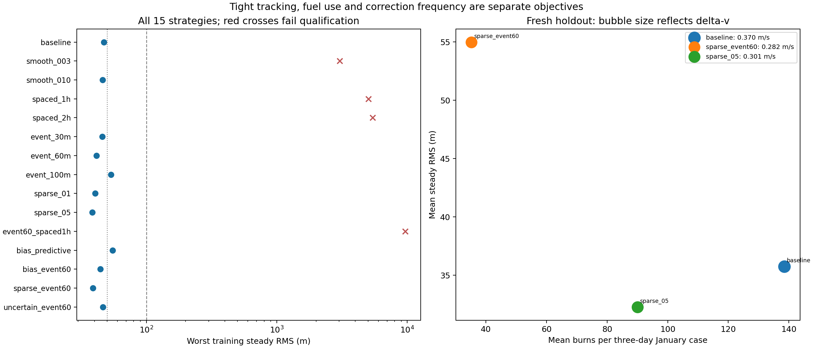
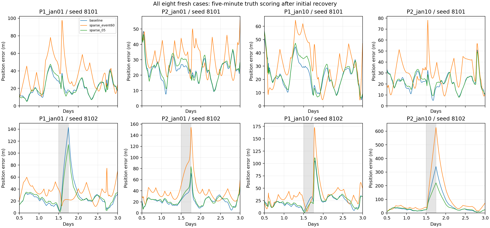

# Executed ARTEMIS MPC strategy comparison

The frozen September search selected **sparse_event60** as the balanced and least-fuel qualified setting, and **sparse_05** for tightest worst-case tracking. Selection preceded the January evaluation.

**The January result favors sparse_05 for further development.** Relative to baseline: mean RMS change -9.73%, mean delta-v change -18.65% and mean burn-count change -35.02%. It passed the broader acceptance limits in all 8 cases. The training-primary sparse_event60 failed those limits in 1 of 8 cases. No tested policy met the tighter 50 m RMS / 300 m peak envelope in every January case. Parameters remain frozen; this development preference interprets the held-out results and is not an independently confirmed deployment choice.

These are three-day synthetic controlled vehicles initialized from definitive ARTEMIS P1/P2 states. The reference is propagated from the initial state; later observed spacecraft states do not enter guidance. Tracking is scored every five minutes after the first 12 hours. Delta-v and burns cover the full three days.

## Fresh January evaluation

Each row covers all eight cases, including four with a six-hour navigation outage and a corrupted fix. “Tight” requires each case to meet 50 m steady RMS and 300 m sampled steady peak. These are sampled tracking bounds, not continuous-time safety guarantees.

| Policy / arithmetic | Mean RMS (m) | Worst RMS (m) | Worst peak (m) | Mean delta-v (m/s) | Mean burns | Mean >90° changes | Mean host CPU (s) | Tight cases |
|---|---:|---:|---:|---:|---:|---:|---:|---:|
| baseline/float64 | 35.766 | 97.757 | 340.573 | 0.370495 | 138.50 | 68.12 | 28.96 | 7/8 |
| sparse_event60/float64 | 54.997 | 173.936 | 626.912 | 0.282051 | 35.25 | 13.75 | 17.68 | 7/8 |
| sparse_05/float64 | 32.287 | 68.361 | 221.260 | 0.301406 | 90.00 | 36.75 | 24.42 | 7/8 |
| sparse_event60/32 | 55.000 | 173.967 | 627.030 | 0.282051 | 35.25 | 13.75 | 17.46 | 7/8 |

Including the initial recovery, mean full-three-day RMS is baseline/float64: 74.931 m; sparse_event60/float64: 86.171 m; sparse_05/float64: 72.917 m; sparse_event60/32: 86.174 m. The largest full-arc sampled error across these runs is 627.030 m. These additional figures include the deliberately perturbed starting state.

Direction changes count the commanded directions of successive burns separated by more than 90 degrees; pointing-error perturbations are not included in this count. It is not an oscillation or stability proof. Host CPU includes navigation and guidance on this machine, and excludes the independent simulated plant. It is not FPGA latency.

## Full training search

| Setting | Qualified | Worst RMS (m) | Worst peak (m) | Mean delta-v (m/s) | Mean burns |
|---|---|---:|---:|---:|---:|
| baseline | yes | 47.268 | 280.471 | 0.359262 | 138.50 |
| smooth_003 | no | 3033.487 | 7863.075 | 0.477012 | 129.25 |
| smooth_010 | yes | 46.220 | 278.701 | 0.346862 | 138.50 |
| spaced_1h | no | 5036.067 | 12229.700 | 0.492238 | 66.25 |
| spaced_2h | no | 5434.473 | 13274.622 | 0.529724 | 36.00 |
| event_30m | yes | 45.977 | 194.582 | 0.287324 | 57.50 |
| event_60m | yes | 41.347 | 224.750 | 0.257477 | 31.25 |
| event_100m | yes | 53.444 | 230.220 | 0.242039 | 23.25 |
| sparse_01 | yes | 40.619 | 252.831 | 0.327741 | 103.25 |
| sparse_05 | yes | 38.545 | 238.781 | 0.293087 | 90.25 |
| event60_spaced1h | no | 9646.975 | 28462.486 | 0.162730 | 21.50 |
| bias_predictive | yes | 55.125 | 305.924 | 0.377363 | 138.50 |
| bias_event60 | yes | 44.478 | 253.461 | 0.262837 | 34.75 |
| sparse_event60 | yes | 38.829 | 216.702 | 0.241884 | 29.75 |
| uncertain_event60 | yes | 46.490 | 276.407 | 0.299930 | 66.00 |

Qualification requires all four September cases to meet 100 m steady RMS and 500 m sampled steady peak, with no collision, solver, arithmetic or first-burn screen failure. The primary and fewest-burn choices use the tighter 50 m / 300 m envelope when available. The 100 m trigger lies on the training Pareto set and uses fewer burns, but missed the tighter RMS envelope; it was not a frozen January finalist.

Four failed settings rejected 38–59 navigation fixes in the difficult P2 outage case, versus one rejected corrupted fix for successful settings. The rejection gate can leave the estimate stale, which inhibits corrections. These records expose a coupled estimation/control failure; isolating its initiating cause requires an estimator-ablation experiment.

## Arithmetic and scope

Selected integer width: **32 total bits / 24 fractional bits**, for the QP core only. The 24-bit variant failed the predeclared 1% tracking-change gate in one training case; no January result was used to select precision.

The primary uses a two-hour horizon with four 30-minute slots, a 60 m predicted coast trigger, sparse weight 0.1, a 0.001 m/s minimum requested correction, and six fixed reweighting/refinement solves of 256 QP iterations when optimization is required. Navigation, force propagation, QP assembly, the trigger and burn screening remain host operations. No FPGA device, synthesis result or measured resource/power advantage is claimed.

The experiment optimizes corrections about a fixed planned orbit. It establishes neither a globally minimum-fuel transfer trajectory nor a separate benefit from shape-sphere coordinates. Three-day scenarios do not validate month-long behavior, real attitude/thruster allocation or emergency mission recovery.

[Protocol and method](artemis-mpc-strategies.md) · [Machine-readable results and receipts](artemis-strategies-results-2026-10-31.json)

## Additional arithmetic qualification

After examining the held-out results, the already frozen sparse_05 finalist was checked with 32/24 integer arithmetic on all 12 September and January cases. All arithmetic gates passed: **True**. Maximum relative RMS change: 0.011955%; delta-v change: 0.003692%; largest burn-count difference: 0. These are reused cases and an arithmetic comparison, not additional independent control-validation evidence.
