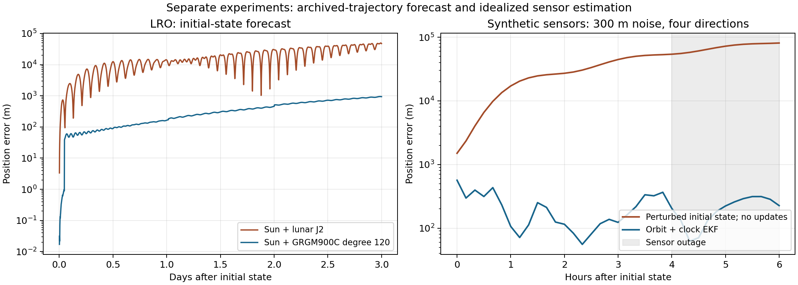

# Lunar gravity, commanded maneuvers, radiation pressure and orbit/clock estimation

The next force-model pass replaces approximate lunar J2 with a published spatial
gravity field, adds independently supplied finite burns and attitude-dependent
SRP, and implements a sequential orbit/clock estimator. The executed forecasts
use only the first spacecraft state. The estimator experiment uses **synthetic
observations** and is reported separately.

## Three-day forecasts against archived trajectories

These are comparisons to reconstructed Horizons ephemerides, not raw flight
measurements. Every comparison uses the same initial state, Moon-centred ICRF
axes, TDB times, preloaded DE440s Earth/Sun ephemerides, and all subsequent
archive samples through day three. No fitted force, epoch adjustment, state
reset, maneuver vector or SRP parameter is inferred from those samples.

| Dataset | Sun + approximate lunar J2 RMS | Sun + GRGM900C degree 120 RMS |
|---|---:|---:|
| LRO, January 2023 | 22.749 km | about **0.460 km** |
| CAPSTONE, February 2023 | 1.916 km | **1.911 km** |
| CAPSTONE, November 2022 | 341.755 km | **341.754 km** |
| Artemis I Orion, November 2022 | 9,733.713 km | **9,733.713 km** |

The nominal 120-second maximum-step LRO run gives 459.308 m RMS, 946.692 m maximum
and 938.993 m final error. Further integration refinement gives about 459.780 m
RMS; the extra digits in the nominal JSON are computational output, not an
accuracy guarantee. LRO improves by approximately **49.5 times** relative to J2.
At rtol 2e-12, halving the maximum step from 15 to 7.5 seconds changes predicted
positions by at most 1.83e-5 m. This checks integration convergence for the
configured forces, not completeness of the physical model.
This is a controlled change in lunar gravity/orientation, with initial state and
other forces held fixed. It demonstrates a large missing-force contribution in
this implementation, without uniquely identifying the remaining residual.

The field was not selected by minimum held-out RMS. Degree sensitivity is:

| Truncation degree | LRO RMS error | Largest position difference from degree 120 |
|---|---:|---:|
| 2 | 9,935.48 m | 17,391.62 m |
| 20 | 6,282.04 m | 10,739.31 m |
| 40 | 708.93 m | 508.19 m |
| 80 | 457.30 m | 54.50 m |
| 120 | 459.31 m | — |
| 180 | 459.86 m | 5.71 m |

Degree 80's slightly smaller RMS is not evidence of a more accurate force model:
truncation error can cancel other errors. The small change from 120 to 180
indicates that simply adding more harmonics is unlikely to remove the remaining
hundreds of metres on this arc. There is also an early residual transition from
about 1 m at 01:08 TDB to 38 m at 01:10. Seven selected archive states, including
those around this transition and the day-one/day-three endpoints, were queried
again from Horizons and agreed within 0.058 m. The transition is present in the
external reference; its cause is not established as a burn or a reconstruction
boundary. No correction was fitted to it.



## Gravity implementation and time-dependent frame

`lunar_gravity.py` reads fully normalized GRGM900C coefficients with their own
GM **4902.79996708864 km³/s²** and reference radius **1738.0 km**. The
[PDS product label](https://pds-geosciences.wustl.edu/grail/grail-l-lgrs-5-rdr-v1/grail_1001/shadr/gggrx_0900c_sha.lbl)
specifies the DE421 principal-axes frame. Accordingly, the implementation uses
`MOON_PA_DE421`, its matching binary PCK and frame kernel. It does not rotate the
coefficients using the approximate IAU pole or a different lunar PA frame.

Cartesian solid-harmonic recurrence evaluates the potential and analytic
gradient, including at the poles. The body-frame acceleration is rotated back
into ICRF. Integration remains in inertial position/velocity coordinates, so no
Coriolis or centrifugal term belongs in this rotation. The complete field
**replaces both the lunar monopole and J2** to avoid double counting. A 600-second
orientation preload was checked against direct CSPICE at 113 off-grid epochs per
dataset, with angular disagreement below 1.35e-11 rad.

The Python reference and C++ accelerator use the same narrow, documented C ABI
in `hardware/lunar_harmonics.h`: SI binary64 vectors, explicitly packed normalized
coefficients, caller-owned buffers, no retained pointers or mutable global
state, and status codes with unchanged outputs on failure. Raw C callers must
supply valid buffers of the documented lengths. Python validates shapes and
retains coefficient/library lifetimes. The SPICE kernel pool is touched only
during serial preload and added kernels are unloaded afterward. This preserves
the existing Python scientific stack and C++ hardware-facing stack; a new
language/runtime is unnecessary. The native library is built explicitly from a
checkout, not bundled or compiled automatically by the Python wheel.

This is a host CPU accelerator. The old cislunar Verlet ABI still implements its
specified J2 model; it does not silently acquire degree-120 gravity. No HLS,
FPGA timing/resource result, device execution or flight qualification is claimed.

## Maneuvers and SRP: explicit inputs rather than residual fitting

`FiniteBurn` supplies inertial thrust direction, force, start/stop times, initial
mass, mass flow, source and availability epoch. The solver splits integration at
burn boundaries and uses the changing mass. A command unavailable at forecast
start is rejected unless retrospective mode is explicitly requested. The
analytic rocket-equation test verifies integrated impulse and post-burn coasting.

Independent NASA reports flag the CAPSTONE arrival-week cleanup maneuvers and
Orion's November 25 insertion. Their broad evidence windows are annotations,
not invented force vectors. The full intervals remain in the score. No event in
the supplied catalog is explicitly **not** a declaration that an arc is burn-free.
Sources: [CAPSTONE](https://www.nasa.gov/news-release/capstone-forges-new-path-for-nasas-future-artemis-moon-missions/)
and [Orion](https://www.nasa.gov/blogs/missions/2022/11/25/artemis-i-flight-day-10-orion-enters-distant-retrograde-orbit/).

An actual archived LRO FDF25 file was downloaded and parsed: May 4, 2015,
35.6-second burn, 2.537 m/s planned scalar delta-v, 1057.105 kg average mass.
Its companion label says calibration uses pre- and post-maneuver orbit solutions.
The file's plan timestamp is after the burn and its inertial thrust-vector file
is not supplied. The parser therefore labels it **retrospective metadata**; it
does not convert a scalar delta-v into an assumed vector or use this 2015 event
in the January 2023 forecast. The inspected PDS small-forces index did not
provide the required 2023 history.

`PlateRadiationPressure` supports independently supplied attitude, mass, plate
area/normals and specular/diffuse fractions. Tests cover absorbing, specular and
Lambertian reflection. Both Python and the existing native cannonball kernel
now handle uniform-disc penumbra and annular eclipse geometry. Simultaneous
Earth/Moon occultations use the larger individual obscuration, not their exact
union; plate self-shadow, thermal recoil and lunar albedo are absent.

Historical LRO cannonball values, area 14 m² and Cr 1.67, are given in a
[NASA orbit-determination paper](https://ntrs.nasa.gov/api/citations/20140008968/downloads/20140008968.pdf).
They are not verified January 2023 attitude/mass properties. Reporting all tested
mass cases, the degree-120 RMS becomes 496.16 m at 1000 kg, 493.06 m at 1057.105 kg,
and 491.81 m at 1100 kg. All worsen this arc relative to the no-SRP baseline.
This exposes inadequate inputs or competing errors; it does not imply that SRP
is physically absent. SRP remains off by default until properties are supplied.

## Sequential orbit and clock estimator

`OrbitClockEKF` evolves position, velocity, receiver clock bias and drift, with
propagated covariance, acceleration/clock process noise, innovation gating and
a Joseph-form measurement update. Its explicit observation contract is
`z = direction · position + clock_bias + noise`, in metres. Force gradients are
computed from the force function, never from future trajectory differences.
Past output snapshots are invariant to changes in future observations.

The executed example uses LRO positions to generate synthetic observations from
four simultaneous tetrahedral directions, 300 m independent Gaussian noise,
600-second cadence and seed 20261031. It starts with a 1.5 km position error,
velocity error `[0.5, -0.5, 0.2] m/s`, and unknown synthetic clock bias/drift.
Measurements stop after four hours; the filter then coasts for two hours.

| Metric | Propagation without measurement updates | Orbit/clock EKF |
|---|---:|---:|
| Position RMS during first four hours | 33.586 km | 252.9 m |
| Position RMS during two-hour sensor outage | 71.589 km | 224.7 m |
| Final position error | 81.111 km | 226.0 m |

Clock-bias RMS is 68.5 m (about 229 ns); final clock-bias error is -78.8 m.
Mean normalized innovation squared is 3.40 for four measurements. This is one
fixed-seed software experiment, not a Monte Carlo consistency certificate.
The chosen directions, simultaneity and unambiguous measurements are idealized.
There is no raw photon/TOA adapter, real pulsar visibility schedule, phase
ambiguity handling, dispersion or complete relativistic timing model here.

## Reproduction and checks

From the source checkout, using a local DE440s kernel:

```sh
python -m pip install '.[test,navigation]'
clang++ -std=c++17 -O3 -shared -fPIC -Wall -Wextra \
  hardware/lunar_harmonics.cpp -o liblunar.so
python -m qrc_pulsar_bench.cislunar_refinement \
  --data-dir ./physics-inputs --download-inputs \
  --ephemeris /path/to/de440s.bsp --native-library ./liblunar.so \
  --days 3 --output ./refinement-results --run-navigation
python -m pytest -q
```

The driver validates SHA-256 hashes for the field, label and matching orientation
kernels, records source/archive/kernel hashes, saves full predicted states and
scores, and reports every degree/SRP sensitivity. The large downloaded field is
not committed into the repository. The optional FDF25 metadata receipt is
included when the independently downloaded sample is present in `--data-dir`.

The full suite passed **235 tests**. Controls include an independent Legendre
potential gradient, analytic J2 and pole limits, Python/native agreement,
no-double-counting, future-value invariance with harmonic gravity, thrust
availability and rocket-equation integration, partial-eclipse native parity,
and clock/estimator covariance and causality. AddressSanitizer and
UndefinedBehaviorSanitizer passed native harmonic evaluations through degree
360 and invalid-input paths. The Python wheel built successfully with the new
modules. Numerical values and source hashes are in
[the results JSON](cislunar-refinement-results-2026-10-31.json).

Remaining physical candidates include lunar solid-body tides with a documented
tide convention, epoch-specific attitude/mass/SRP and thermal recoil, complete
maneuver histories, Earth oblateness, other planetary perturbations and
relativity. Reconstruction/state covariance also matters. Real onboard
measurements are needed to validate the sensor adapter and estimator. These
results do not establish a separate computational advantage from direct
shape-sphere evolution, nor do they validate unrelated Jovian/sample-return
mission outcome or FPGA latency claims.
