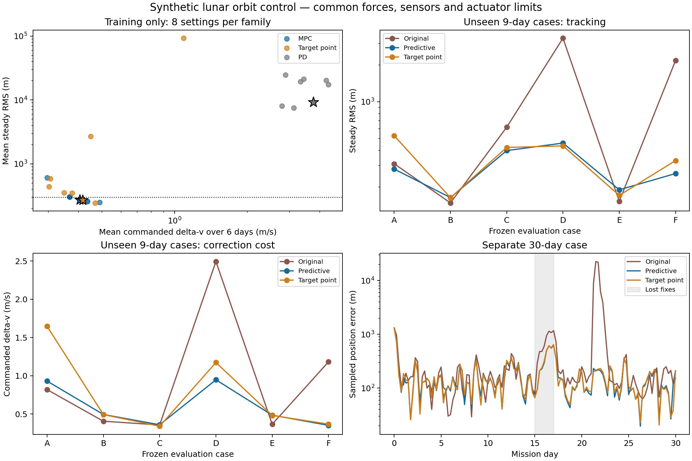

# Matched controller tuning and an explicit advantage test

This experiment improves the first Jacobi controller and tests where its
benefits come from. It does not take “Jacobi is better” as an assumption. A
coordinate representation, a guidance policy, a navigation estimator and a
hardware implementation are different potential sources of benefit.

The implementation adds:

- A causal nine-state filter for Moon-relative position, velocity and a slowly
  varying inertial acceleration bias. It uses delayed direct-state fixes with
  their measurement epoch and an explicit command-knowledge cutoff.
- Innovation gating for bad fixes, Joseph covariance updates, process noise
  for uncertain forces, and approximate maneuver execution covariance.
- Bias-aware predictive rollouts and planning. The reference keeps the nominal
  force model; the estimated disturbance enters the spacecraft prediction and
  compensation, so adding it to both sides cannot silently cancel it.
- A matched Moon-centered Cartesian implementation using the same physical
  forces and numerical integrator, plus PD and conventional target-point
  guidance baselines with the same finite-burn checks and actuator constraints.
- A written training/evaluation split, paired sensor and actuator randomness,
  frozen training selection, and a separate month-long scenario.

Files are `qrc_pulsar_bench/adaptive_control.py`,
`qrc_pulsar_bench/control_tuning.py`, and `tests/test_adaptive_control.py`.
The original controller gained two extension points for linearization and
candidate generation; its default behavior and public interface are preserved.

## What changed after the pilot

The first filter pilot was overconfident about changing forces. After an
unmodelled disturbance it rejected valid fixes and allowed the estimated state
to diverge. This was an actual failed test, not a successful robustness result.
The repeated pilot includes random-walk force uncertainty and maneuver
magnitude/pointing covariance. It accepts ordinary fixes and rejects the single
injected corrupt fix. Both pilot receipts are retained; neither pilot is an
evaluation case.

Direct-state measurements are still synthetic. Estimating an acceleration bias
does not identify which force caused it, nor does it close missing attitude,
mass, thermal or sensor-model inputs. The direct fixes are assumed independent;
feeding an already-filtered navigation product would require its correlation
with this estimator to be handled. Innovation gating cannot distinguish
every coherent sensor fault from a real trajectory change. Its calibration is
reported using innovation and state-error statistics, not assumed from a
successful solve.

## Frozen comparison protocol

The plant is propagated independently in Moon-relative Cartesian coordinates
using the sourced lunar/planetary force model. Every controller receives the
same planned physical orbit, sensor cadence, ten-minute delivery delay,
measurement error draws and physical actuator limits. Future true spacecraft
states never enter the controller. True state is used to generate available
measurements and to compute diagnostics afterward.
The plant and controller share the nominal force implementation; their
differences are the declared disturbances, actuation errors and integration
settings. A force error shared by both would not be exposed by this experiment.
This is a control comparison, not another validation against observed flight
trajectories.

The plant additionally receives a declared unmodelled acceleration, a force
episode, thrust magnitude error and thrust pointing error. Actuator error draws
are keyed to decision epochs; taking fewer burns does not change the random
sequence used by another method. Fuel flow is commanded while delivered thrust
is imperfect, so mass accounting stays explicit. Sensor-outage cases withhold
fix deliveries. The outlier is a declared corrupted position/velocity fix, not
a force inferred from a trajectory residual.

Training uses three six-day scenarios, seeds 1101–1103, lunar radii 8,000,
10,000 and 14,000 km, and inclinations 35, 55 and 70 degrees. Each guidance
family gets eight configurations. An initial four-configuration training pass
showed that the target-point baseline also needed a fuel-weight sweep. The grid
was expanded equally for all families using training results only, before any
evaluation cases were opened; both passes are retained:

| Family | Parameters explored |
| --- | --- |
| Predictive | Fuel penalty, one/two-day horizon and hysteresis deadband |
| Damped PD | 6, 8, 10, 12, 18, 24, 36 and 48-hour response time |
| Target point | Targets 6, 12, 24 or 48 hours ahead, plus fuel-weight alternatives at 6/12 hours |

The conventional target-point controller solves a weighted position/velocity
correction using the same state-transition model. It supplies a stronger
comparison than PD alone at a six-hour correction cadence. Similar target-point
and orbit-maintenance studies explicitly account for navigation and maneuver
execution errors; see the [ARTEMIS station-keeping analysis](https://artemis.igpp.ucla.edu/pubs/2010_nonrefereed/AAS_10-113.pdf)
and [NASA's NRHO orbit-determination study](https://ntrs.nasa.gov/citations/20200011550).

Selection reads **training results only**. A candidate must have mean steady
RMS at most 300 m, worst training-scenario steady RMS at most 500 m, maximum
sampled error at most 5 km, and no decision exceeding the declared budget of
5,000 online force evaluations. Among qualifying candidates, minimum average
commanded delta-v wins. If none qualify, the result says so and selects the
smallest worst-case RMS only for further diagnosis. It does not relabel that
candidate as meeting the requirements.

Steady RMS excludes the initial 24-hour acquisition interval. Full-interval RMS,
maxima and final error remain in the receipts. These thresholds and exclusions
are experiment requirements, not mission requirements inferred from NASA data.
The computational criterion is a benchmark eligibility test, not a certified
execution deadline or an enforced flight watchdog.

Evaluation uses six different nine-day scenarios, seeds 2201–2206, radii 7,000,
12,000 and 16,000 km, inclinations 25, 50 and 65 degrees. Cases include stronger
measurement noise, up to 8% thrust dispersion, pointing error, one-day lost-fix
intervals, force mismatch and corrupted fixes. The selected settings remain
frozen. Source and protocol hashes must match training or evaluation refuses
to run. A separate 30-day scenario uses seed 3301 and a two-day lost-fix interval.

The comparison includes the original raw-fix controller, tuned predictive
guidance, tuned PD, tuned target-point guidance, the identical predictive policy
in Cartesian coordinates, and an acceleration-feedforward ablation. The
ablation retains the same filter but does not feed its acceleration estimate
to guidance. It therefore isolates that guidance input, not all effects of
bias estimation inside navigation.

The completed 72-run training pass selected `mpc_1day_balanced` (one-day
horizon, delta-v cost scale 0.075 m/s) and `target_6h_precise` (six-hour
target, delta-v cost scale 0.1 m/s). Their mean training steady RMS values
were 272.84 and 270.87 m, with mean commanded delta-v 0.40462 and
0.41591 m/s respectively. The predictive controller used 2.7% less delta-v
with 0.7% higher error on training. The selected diagnostic PD configuration
was `pd_8h`; none of the eight PD candidates met the training constraints.
This finding applies to this sampled controller and six-hour actuation cadence,
not all possible PD controllers.

## Completed frozen evaluation

The final campaign completed 72 training runs, 36 evaluation runs and four
30-day runs. The aggregate below is the arithmetic mean of scenario RMS values
and commanded delta-v across the six nine-day evaluation cases. Steady RMS
excludes the first day; errors are sampled every six hours. Online CPU includes
guidance and navigation, excludes reference construction and truth simulation,
and is host process time for the entire nine-day case.

| Controller | Mean steady RMS (m) | Mean commanded delta-v (m/s) | Mean online CPU (s) |
| --- | ---: | ---: | ---: |
| Original raw-fix controller | 1,121.42 | 0.9376 | 13.22 |
| Tuned predictive, Jacobi | 291.64 | 0.5951 | 19.04 |
| Tuned target point | 341.49 | 0.7508 | 15.23 |
| Tuned sampled PD | 5,650.54 | 4.6872 | 14.33 |
| Identical predictive policy, Cartesian | 291.64 | 0.5951 | 18.08 |
| Predictive, bias feedforward disabled | 312.75 | 0.5323 | 18.34 |

Relative to the tuned target-point baseline, predictive guidance reduced mean
steady RMS by **14.6%** and mean commanded delta-v by **20.7%**, while using
**25.0% more online CPU**. This is a measured tradeoff across this case set,
not dominance in every case. Its worst scenario steady RMS was 458.92 m;
the maximum sampled position error, including acquisition, was 1,735.93 m.
Every decision remained below the 5,000-force-evaluation benchmark limit.

| Case | Main condition | Predictive RMS / delta-v | Target-point RMS / delta-v |
| --- | --- | ---: | ---: |
| A | 7,000 km radius, ordinary fixes | 280.81 m / 0.9305 m/s | 527.34 m / 1.6466 m/s |
| B | 12,000 km radius, ordinary fixes | 164.02 m / 0.4945 m/s | 163.62 m / 0.4930 m/s |
| C | 16,000 km radius, one-day outage | 397.99 m / 0.3600 m/s | 422.42 m / 0.3412 m/s |
| D | Noisier fixes and one corrupt fix | 458.92 m / 0.9477 m/s | 435.14 m / 1.1739 m/s |
| E | Stronger thrust/pointing and force error | 189.94 m / 0.4855 m/s | 171.07 m / 0.4818 m/s |
| F | One-day outage, corrupt fix, larger force bias | 258.18 m / 0.3523 m/s | 329.37 m / 0.3682 m/s |

Predictive guidance improves both metrics in A and F, loses both in B and E,
and trades accuracy against fuel in C and D. All cases also include the
declared force mismatch and actuator dispersion; “ordinary” does not mean an
error-free plant. The original controller also beats the new predictive
configuration on both metrics in B and E. The aggregate improvement over
the original (74.0% lower steady RMS, 36.5% lower delta-v) therefore primarily
supports robustness to the included fault conditions, rather than a universal
efficiency improvement.

The feedforward ablation exposes a remaining weakness. Disabling the bias
input to guidance improved both error and fuel in five of the six cases. In
C, however, its RMS rose from 397.99 to 669.34 m, so the overall average RMS
was worse. Always applying the estimated bias is not yet an efficient policy.
Confidence-dependent disturbance compensation is a candidate for a new training
cycle and new evaluation cases; it has not been tuned against these results.

The two coordinate versions produced essentially the same policy outcomes:
maximum difference in scenario steady RMS was 0.000120 m, and maximum difference
in total commanded delta-v was 0.000000712 m/s. No unique Jacobi physical or
control-policy advantage is established by this comparison.

## Separate month-long result

The frozen month case withheld fixes during days 15–17 and corrupted one fix
on day 21. It also included the force episode and actuator imperfections.

| Controller | Steady RMS (m) | Delta-v (m/s) | Propellant (kg) | Burns | Online CPU (s) |
| --- | ---: | ---: | ---: | ---: | ---: |
| Original | 3,103.33 | 2.2358 | 0.5179 | 101 | 38.72 |
| Predictive | 193.33 | 1.3147 | 0.3046 | 106 | 56.90 |
| Target point | 195.10 | 1.3617 | 0.3155 | 108 | 46.44 |
| Sampled PD | 114,185.81 | 22.9213 | 5.2840 | 95 | 47.01 |

Predictive and target-point full-interval RMS values were 235.98 and 235.93 m,
respectively: tracking was effectively tied including acquisition. Predictive
guidance used 3.45% less delta-v, or approximately 11 g less propellant under
the assumed 500 kg spacecraft and 220 s specific impulse. This is a small
planning benefit. Both greatly improved on the original during the bad-fix
event. The predictive run's maximum sampled error was 1,315.52 m, including
the initial offset, and its maximum online force count was 4,820 per decision.

The selected predictive filter rejected exactly the injected outlier in each
applicable evaluation/month case and no ordinary fixes. Evaluation median
six-dimensional innovation statistics were 3.64–5.17 and mean six-dimensional
state-error statistics were 4.67–5.32. A correctly calibrated Gaussian model
has a nominal innovation median of about 5.35 and state-error mean of six.
These small, correlated samples do not
establish calibrated collision probabilities. No bias clipping occurred.



The [machine-readable summary](controller-advantage-results-2026-10-31.json)
contains every evaluation case, full-interval metrics, selections, input hashes,
coordinate measurements and references to raw receipts. Complete local receipts,
frozen source snapshots and the parallel runner are in
`/Users/hendrixx./qrc-control-expanded-2026-10-31/`. The failed pilot and initial
four-configuration training pass are retained separately; neither replaced a
failed evaluation with a better-looking rerun.

## Accuracy, computation and remaining scope

Both coordinate implementations use the same binary64 force model, DOP853
tolerances and collision guards. The independent plant uses a smaller maximum
step. The earlier ninety-day coordinate control remains numerical evidence;
using the same tolerances alone does not establish a general coordinate
accuracy advantage. The full force/coordinate conventions are in
[the original controller guide](jacobi-predictive-control.md).

There is also an exact structural check. In this restricted implementation the
inner Earth–Moon motion is prescribed and the two state representations differ
by a known time-dependent translation. Both the actual and reference state
receive the same translation, so `delta_q = delta_r` and
`delta_q_dot = delta_v`. Their force Jacobians, physical constraints and control
costs are identical in exact arithmetic. Consequently a distinct optimal burn
policy cannot arise solely from this coordinate translation. Differences in
runtime or numerical conditioning must be measured separately, and navigation
or planning gains should not be attributed to a new physical law.

A separate accuracy sweep compares both propagators at several tolerances on
the training-orbit geometries, with two reversed-order repetitions. Maximum
physical position error is measured against an independently refined Cartesian
control. This addresses the unequal physical accuracy that can result from
using the same relative tolerance on differently sized coordinate vectors.

For the fastest tested setting meeting a 0.1 m maximum numerical error target,
Jacobi/Cartesian CPU ratios were 1.14, 1.48 and 1.06 on the three training
orbit geometries. At a 1 m target those ratios were 0.99, 0.89 and 1.06.
The independently refined control changed by at most 0.0053 m. These are
two-repetition measurements on an Apple M2 Pro and a bounded tolerance/step
grid, rather than an optimized implementation comparison or a statistical
speedup claim. They establish no general coordinate speed advantage.

Reported process CPU separates guidance and navigation. Reference construction
is offline and excluded for every method. Some independent cases run in
separate processes with separate ephemeris/SPICE state; process CPU is not a
flight processor latency, FPGA resource estimate or power measurement. Force
evaluation counts provide a separate reproducible measure of online work.

The filter integrates its mean under the complete model and uses piecewise
midpoint linearization for covariance. Finite-burn uncertainty is approximated
at burn completion with a half-burn position correlation. Neither is a full
nonlinear uncertainty distribution or coupled attitude/propulsion estimator.
Partial-burn estimation, correlated/biasing sensors, actual sensor observation
models, multiple spacecraft hazards and rapid interrupt-driven safety checks
remain outside this experiment. The legacy emergency supervisor and its
finite-horizon limitations remain unchanged.

All errors and savings are conditional on these synthetic scenarios. Six
evaluation cases cannot establish a flight-failure probability, universal
nonoscillation, fuel savings on arbitrary missions or a unique QRC advantage.
The monthly run tests repeated one-day replanning over a month; it does not
certify an open-loop burn schedule months into the future. Frequent small
corrections remain possible at the six-hour decision cadence.

## Reproduction

Use the physical input files and native harmonic library described in
[the original controller guide](jacobi-predictive-control.md). Each phase writes
tracking/navigation errors, bias estimates, commands, statistics, source hashes and
its frozen protocol:

```sh
python -m qrc_pulsar_bench.control_tuning \
  --physics-dir /path/to/gravity-and-orientation \
  --ephemeris /path/to/de440s.bsp --gm-kernel /path/to/gm_de440.tpc \
  --native-library /tmp/liblunar.so --output /tmp/control-comparison --phase train

# Repeat with the same arguments and --phase evaluate, then --phase month.
PYTEST_DISABLE_PLUGIN_AUTOLOAD=1 python -m pytest -q

# After all phases finish, create the compact receipt and figure:
python -m qrc_pulsar_bench.control_advantage_report /tmp/control-comparison /tmp/control-report
```

The report includes coordinate-sweep receipts when present. It checks the
archived source directory, or the installed source when no archive exists,
against the recorded hashes. Its checks reject incomplete case sets, mixed
source/protocol hashes and a changed training selection. The local campaign
directory contains both sweep scripts, frozen source and their complete outputs.

Verification on the completed source state: **320 tests passed**, with one
pre-existing PINT extended-precision warning on this platform. The wheel builds
and includes the new filter, experiment and reporting modules. The Python source
parses against the declared Python 3.9 syntax baseline; execution used Python
3.13 on macOS/Apple M2 Pro. The six force/actuation source dependencies remained
unchanged throughout the campaign; input data and native-library hashes are in
the receipts.

Recall tripwire `5347d07a` and all five entries in its uncapped impact report
were inspected against their source scripts. The assigned “certification”
numbers in the standalone confrontation script do not provide controller or
held-out trajectory evidence and have no executable import bridge into this
experiment. The earlier `f076a74d` boundary continuation was checked through its
saved dependency audit; the current force/native-bridge tests also passed.
These are scoped applicability checks, not a re-proof of the surrounding
theory graph.

The prototype's independent analytic tests cover random-walk covariance,
constant acceleration identification, delayed updates, outlier recovery,
command availability and mass accounting, execution covariance, bias
feedforward and matched-coordinate commands. The original finite-burn,
clearance, force and language-bridge checks remain required.
