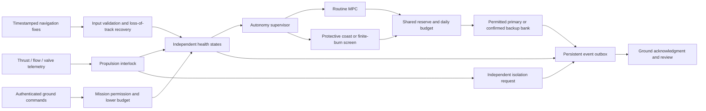

# Five layers of ground-supervised recovery

This implementation extends the frozen compound-fault campaign with persistent
navigation recovery, an independent propulsion interlock, a protective planner,
orthogonal health monitoring, and authenticated ground authority. It is a host
simulation prototype. Hardware independence, sensor performance and actuator
availability are explicit assumptions, with failed-isolation counterexamples.

## Flight interfaces and information boundaries

`LossOfTrackFilter` receives only timestamped navigation fixes, their reported
covariance and the known command ledger. `PropulsionGuard` receives timestamped
thrust magnitude, propellant flow and isolation-position indications, plus the
expected commanded thrust. `AutonomousMPC` receives the navigation estimate,
estimated mass, interlock state and ground authority. The protective planner uses
that estimate and the existing force model and mission reference.

The truth-side `GuardedPlant` creates synthetic thrust/flow telemetry with noise
of 1 mN and 1e-7 kg/s at 60-second cadence. This is a new independent sensor
assumption; the preceding campaign had only synthetic orbital fixes. Fault
names, schedules, directions, actual mass and exact plant states are not passed
to the flight policy. The sensor adapter may observe physical actuator output,
as a real pressure/flow/thrust measurement would, but does not report a fault
classification or future output.

The original `CompoundExperiment` remains available with `layered=False`.
`layered=True` opts into the new stack. Existing square-root navigation,
finite-burn propagation and C++ QP ABI are retained. The separate
`thruster_allocation.py` module recently added to the repository models a more
detailed RCS cluster and slewing; this campaign does not yet couple that module's
attitude and individual thruster dynamics into orbital propagation. Its tests
are included in the repository checks.



## 1. Persistent measurement rejection

The earlier failure occurred because accepted-track age exceeded the maneuver
candidate's three-hour limit, while continuously received but rejected packets
prevented observation-gap recovery. `LossOfTrackFilter` adds a separate trigger
after three hours of consecutive rejection and a stale accepted track. It arms
a candidate for the next distinct measurement, without reusing the triggering
fix. This candidate needs five dynamically consistent fixes spanning two hours;
ordinary recent-maneuver recovery retains its existing three-fix rule.

Malformed, future and replayed packets cannot arm this path. Candidate rejection
does not erase the persistent-loss condition. Promotion replaces the old state
and covariance factor; it does not incorrectly fuse correlated hypotheses.
Coherent sensor corruption can still imitate physical motion. These gates are
consistency checks, not authentication of a real velocity change.

## 2. Independent propulsion protection

When no meaningful thrust is commanded, measured thrust above 20 mN and flow
above 1e-5 kg/s must agree at two successive valid samples before the guard
requests primary isolation. One indication alone does not suffice. The primary
shutoff remains latched. A backup bank is enabled only after two samples confirm
that the isolation valve is closed and measured force and flow are quiet.

The simulator integrates the actual force and mass flow to the exact commanded
isolation time. When `isolation_available=False`, the request does not close the
plant valve, the flow continues, and the backup remains inhibited. Guidance
continues observing and reporting this state. This deliberately tests the
hardware dependency instead of assuming that an issued command executed.

The backup is modeled as an independent actuator with the same nominal thrust
and Isp. Primary gain and pointing faults do not transfer to it. That capability
requires a real propulsion design; it is not supplied by MPC or by the QRC
coordinate formulation. Scalar thrust/flow telemetry does not diagnose every
mispointing, internal leak, sensor common-cause fault or attitude failure.

## 3. Bounded protective trajectory planning

The routine 5 km / 0.5 m/s error envelope remains unchanged. Outside it, a
separate planner considers coasting, an MPC proposal and bounded axis burns.
Each accepted candidate is propagated with finite thrust and mass depletion for
up to six hours across 13 perturbed initial states. Perturbations use six times
the supplied covariance factor. Lunar and Earth clearance floors and propellant
reserve must hold for all screened points. A feasible screened coast is preferred
to spending protective authority on mission tracking. If coasting fails, feasible
burns are ranked first by effort, then by worst terminal reference error. The
original reference is retained.

All routine and protective commands share a 1 m/s rolling daily budget. Ground
can lower this allowance. The planner reports `no_screened_candidate` when its
bounded search finds no feasible option. That result inhibits thrust; it is not
a claim that coasting is safe, or that no feasible maneuver exists anywhere.

Return to routine mode requires a trusted estimate within the tighter 2.5 km /
0.25 m/s corridor for two hours. The spent budget survives the transition.
Independent numerical tests include a modeled impact under coasting and a
screened finite burn that avoids it. This does not prove real spacecraft
collision avoidance: the ensemble is finite, clearance is sampled, force and
actuator uncertainty are incomplete, and covariance calibration remains open.

## 4. Health monitoring during every mode

Navigation trust/age, primary or backup propulsion state, ground-link state,
mission permission and propellant reserve have independent health entries and
bounded transition logs. These update before the supervisor returns an inhibit
decision. The faster propulsion monitor runs during navigation outages, ground
holds and recovery maneuvers. One active problem cannot hide a later problem
merely by selecting a single global failure state.

Power, thermal, radiation and full attitude health require corresponding plant
and sensor models; this experiment does not fabricate those observations.

## 5. Ground supervision and persistent evidence

`GroundAuthority` validates a mission identifier, HMAC authentication, monotonic
sequence number, issue/not-before/expiry epochs and a restricted action set.
Commands can hold or resume mission corrections or lower the daily budget.
They cannot bypass local navigation, reserve or propulsion interlocks. A ground
mission hold retains protective action when the finite-horizon coast screen
fails. Sequence and authority state can be saved atomically with authentication;
tests exercise restart, replay, expiration, tampering and storage failure.

The campaign uses an ephemeral simulation key and a local command source. No
key is included in reports, and no external ground station is contacted. Real
key provisioning, key rotation, radio transport, clock synchronization, physical
anti-rollback storage and mission authorization are outside this prototype.

The existing event outbox queues health changes, reacquisitions, isolation and
backup events, issued maneuvers and ground-command decisions for acknowledgment
on reconnection. Persistent ground authority and the event outbox are separate:
failure to save a command rejects the authority change before applying it.

## Validation protocol

Development cases reproduce the prior failures and remain archived. The final
campaign freezes code, tests, C++ sources, input kernels, fault schedules and
ground commands before execution. It reruns all 20 prior scenarios on P1/P2 with
float and integer MPC, then uses new seeds and six new schedules, including failed
isolation, delayed ground commands and a kick beyond routine authority. Matched
legacy runs accompany fresh cases where the same interfaces permit a comparison.

Navigation restoration and mission-path restoration retain the previous final
six-hour criteria. Reports include all failures, actual fuel use, measured
isolation latency, authority checks and float/integer differences. Regression
improvements and fresh-scenario outcomes are reported separately.

The main scripts are `scripts/artemis_layered_campaign.py` and
`scripts/report_layered_autonomy.py`. Evidence is stored under
`/Users/hendrixx./qrc-layered-autonomy-2026-11-01`. Only the existing QP executes
in integer host emulation; the supervisor, navigation and trajectory screens
are Python/float64. There is no FPGA synthesis, flight timing or power result.
Host computation time does not advance the simulated orbit clock. An actual
implementation must independently schedule the propulsion interlock and prove
watchdog and deadline behavior; separation of Python classes does not provide
hardware fault independence.

```sh
python scripts/artemis_layered_campaign.py \
  --output /Users/hendrixx./qrc-layered-autonomy-2026-11-01/final-campaign \
  --data /Users/hendrixx./qrc-mpc-strategies-2026-10-31/data \
  --kernels /Users/hendrixx./qrc-cislunar-data-2026-10-30 \
  --physics /Users/hendrixx./qrc-force-followup-2026-10-31 \
  --native /Users/hendrixx./qrc-force-followup-2026-10-31/liblunar.so --workers 8
python scripts/report_layered_autonomy.py \
  --root /Users/hendrixx./qrc-layered-autonomy-2026-11-01 \
  --baseline /Users/hendrixx./qrc-compound-failures-2026-10-31 \
  --output docs/artemis-layered-results-2026-11-01
```
